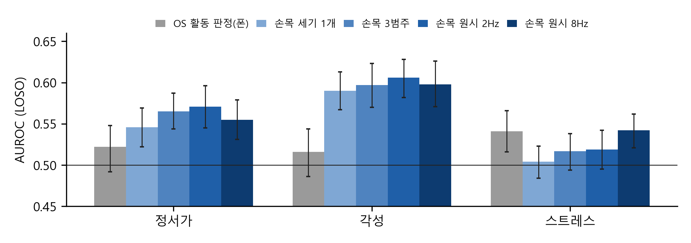
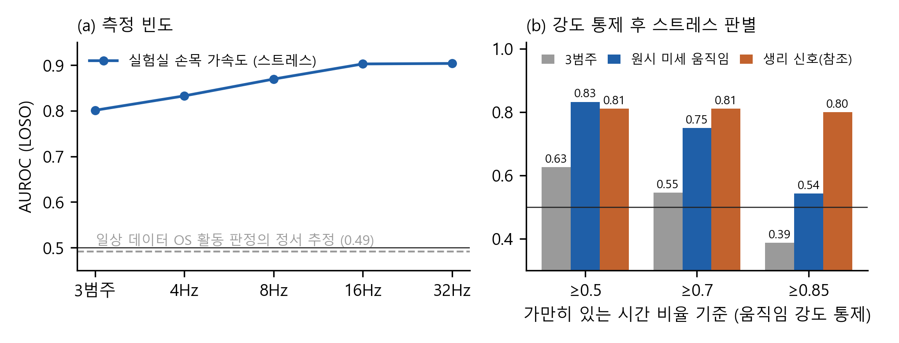

# 움직임 신호의 정서 정보는 어디에 있는가: 실험실·일상 데이터 비교와 온디바이스 구현

## Where Is Affective Information in Motion Signals? A Lab-to-Daily-Life Analysis and On-Device Implementation

강정모
Kang Jeong Mo
202620044@seoil.ac.kr

서일대학교 정보통신공학과, 전공심화

> 【표기 규칙】 【미실시】=아직 안 한 실험, 【설계안】=구현 전 계획, 【…예정】=쓸 내용 미작성. 표시 없는 수치는 모두 실제 실행 결과(results/*.csv)임.

## Abstract

Motion sensors are a low-cost, low-intrusion source for estimating a user's affective state, but it is unclear which part of the motion signal carries affective information. We apply one analysis pipeline to three public datasets and compare OS-level activity categories, wrist movement intensity, and raw accelerometer features at several sampling rates. Under leave-one-subject-out evaluation, OS activity categories predicted momentary valence and arousal only at chance level in both daily-life datasets (StudentLife, 49 users: AUROC 0.49/0.50; K-EmoPhone, 77 users, 3,771 reports: 0.52/0.52). Continuous wrist motion predicted arousal better than OS activity (0.60, +0.08 [95% CI 0.05, 0.11]), but a single intensity feature explained most of this gain, and raising the sampling rate from 2 to 8 Hz gave no improvement. Raw features added information beyond intensity only for stress: in the laboratory (WESAD, 15 users), they kept an AUROC of 0.83 after matching movement intensity (activity categories: 0.63), while in daily life the gain was small (+0.04 [0.02, 0.06], absolute 0.54). Thus, for daily arousal, low-rate wrist intensity is sufficient, while fine-grained motion matters mainly for stress. We implemented the feature extraction and inference on a smartphone without network permission; one window took 0.16 ms (2 Hz) to 3.8 ms (32 Hz) for features and about 20 μs for inference. We also added an on-device daily-logging mode that stores 52 facial blendshape coefficients (no images) as dense labels alongside hand motion, app context, and explicit like/dislike input; a first-day check (18 min, 43 ratings) confirmed the pipeline, with face detection in 77% of frames while watching videos but only 32% while listening to music, and no motion–expression association survived correction.

**Keywords**: affective computing, mobile sensing, accelerometer, stress detection, on-device AI

---

## I. 서론

스마트폰과 웨어러블 기기는 사용자의 움직임을 하루 종일 기록한다. 이 기록으로 스트레스나 기분 같은 정서 상태를 추정할 수 있다면 정신 건강 관리, 집중 관리, 충동 소비 예방, 운전·작업 안전 등 여러 분야에 활용할 수 있다. 움직임 센서는 카메라나 마이크보다 거부감이 적고 전력 소모도 작아 일상 환경에 적합하다.

그러나 움직임 신호의 어느 부분에 정서 정보가 있는지는 분명하지 않다. 모바일 운영체제는 원시 가속도 대신 '정지·걷기·차량' 같은 활동 범주를 앱에 제공하는 경우가 많고, 기존 대규모 모바일 센싱 데이터셋도 이 범주 값만 저장한 경우가 많다. 반대로 원시 가속도를 높은 주파수로 계속 수집하면 배터리 소모가 커지고, 서버로 보내면 개인정보 부담이 생긴다. 어떤 정보가 필요한지 알아야 수집 방식과 처리 위치를 정할 수 있다.

본 논문은 세 가지 질문에 답한다. 첫째, OS 수준의 활동 범주만으로 정서를 추정할 수 있는가. 둘째, 원시 가속도는 움직임 세기 이상의 정보를 주는가. 셋째, 그 정보는 샘플링 주파수를 높일수록 늘어나는가. 실험실 데이터셋(WESAD)과 일상 데이터셋 두 개(StudentLife, K-EmoPhone)에 같은 분석 절차를 적용하여 정서가·각성·스트레스별로 답을 비교한다. 이어 특징 추출과 추론을 네트워크 권한 없이 스마트폰 안에서 실행하는 시스템을 구현하고 단말 비용을 측정한다. 마지막으로 이 시스템을 음악·영상·피드 같은 콘텐츠 이용 중의 감정 피드백으로 넓히기 위해, 앞카메라 표정 계수를 단말에서 추출하여 움직임 신호의 정답으로 삼는 일상 기록 기능을 구현하고 1인 파일럿을 시작하였다.

---

## II. 관련 연구

### 2.1 모바일·웨어러블 정서 센싱

StudentLife는 대학생 48명의 스마트폰 센싱 데이터와 사진 기반 정서 척도(PAM) 응답을 10주간 수집하였다[1,2]. K-EmoPhone은 대학생 77명의 스마트폰·손목 기기 데이터와 정서가·각성·스트레스 자기보고 5,582건을 7일간 수집하였고, 참가자 단위 교차검증에서 macro F1 0.52~0.54 수준의 기준 성능을 보고하였다[3]. WESAD는 15명에게 실험실에서 스트레스(TSST)와 즐거움을 유도하고 손목·가슴 센서 신호를 기록한 데이터셋이다[4]. 일상 환경 연구는 정서 추정 성능이 낮고, 실험실 연구는 성능이 높지만 조건이 통제되어 있다.

### 2.2 움직임 신호 기반 정서 추정

Wampfler 등은 82명이 10주간 스마트폰으로 타이핑할 때의 터치와 관성 센서 신호로 정서가·각성을 예측하였고, 관성 센서만으로도 AUC 최대 0.83을 얻었다[5]. Woll 등은 259명의 일상 데이터에서 원시 가속도로 순간 기분을 예측하였고, 부착 위치 중 손목이 가장 약하다고 보고하였다[7]. 그러나 이들 연구는 원시 신호와 OS 수준 활동 범주, 움직임 세기, 서로 다른 샘플링 주파수를 같은 절차에서 비교하지 않았다. 샘플링 주파수 비교는 낙상 감지[8] 등 다른 과제에서만 이루어졌다.

한편 WESAD의 스트레스 과제는 서서 말하는 방식이라 움직임이 많다. 최근 연구는 평균 절대 저크 하나만으로 스트레스를 AUROC 0.828로 구분할 수 있으며, 이는 스트레스 생리가 아니라 실험 프로토콜의 차이라고 지적하였다[9]. 본 논문은 이 교란을 움직임 강도 통제로 다루고, 같은 비교를 일상 데이터에서 반복하여 실험실 결과가 일반화되는지 확인한다.

### 2.3 온디바이스 처리

정서 상태는 민감한 개인정보이므로 원시 센서 데이터를 서버로 전송하지 않고 단말에서 처리하는 것이 바람직하다. 경량 결정트리 모델은 모바일 기기에서 짧은 시간 안에 추론할 수 있어 온디바이스 정서 추정의 현실적인 선택지이다. 【온디바이스 관련 참고문헌 1~2건 추가 예정】

---

## III. 시스템 설계 및 구현

### 3.1 시스템 설계

#### 3.1.1 개발 환경

본 논문의 개발 환경은 **표 1**과 같다. 분석에는 Python 3.11.9를 사용하였다. 특징 추출에는 NumPy와 SciPy의 신호처리 함수를, 분류 모델에는 LightGBM[6]을, 평가에는 scikit-learn을 사용하였다. 단말 구현은 Java로 작성하였고, 갤럭시 노트9(Android 10)에서 측정하였다.

**표 1. 개발 환경**

| 구분 | 항목 | 버전 |
|---|---|---|
| 언어 | Python / Java(JDK) | 3.11.9 / 17 |
| 데이터 처리 | pandas / NumPy | 2.3.3 / 2.1.3 |
| 신호처리 | SciPy | 1.15.3 |
| 분류 모델 | LightGBM | 4.7.0 |
| 평가 | scikit-learn | 1.8.0 |
| 단말 빌드 | Android Gradle Plugin / Gradle | 8.9.1 / 8.13 |
| 카메라 / 표정 추출 | CameraX / MediaPipe Face Landmarker[10] | 1.4.2 / 0.10.35 |
| 단말 | Galaxy Note9 SM-N960N (Exynos 9810) | Android 10 |

#### 3.1.2 시스템 구성

시스템은 네 단계로 구성된다(**그림 1**). 첫째, 수집 단계에서 전경 서비스가 3축 가속도를 정해진 주기로 읽어 링 버퍼에 저장한다. 둘째, 특징 추출 단계에서 15초마다 최근 60초 신호를 일정 간격 격자로 보간한 뒤 3.1.3의 특징을 계산한다. 셋째, 추정 단계에서 결정트리 모델이 정서 상태를 확률로 출력한다. 학습된 LightGBM 모델은 트리 구조를 텍스트로 평탄화하여 단말에 넣었으며, 단말의 특징값과 확률이 Python 결과와 일치하는지 자체 검사로 확인한다. 넷째, 해석 단계에서 추정 결과를 사용자에게 보여주고 기록한다. 【설계안: 넷째 단계(사용자 표시·기록 화면)는 아직 구현하지 않음. 현재는 측정 로그만 기록】 앱에는 인터넷 권한을 두지 않았으므로 원시 신호와 추정 결과가 단말 밖으로 나갈 경로가 없다. 【그림 1: 시스템 구성도 추가 예정】

콘텐츠 이용 중의 감정 반응을 학습할 정답을 얻기 위해 일상 기록 모드를 추가하였다. 전경 서비스가 가속도와 자이로를 약 50Hz로 상시 기록하고, 화면이 켜져 있는 동안에는 앞카메라 프레임을 초당 2장 MediaPipe Face Landmarker[10]에 넣어 표정 계수(blendshape) 52개만 저장한다. 카메라 영상과 얼굴 이미지는 저장하지 않는다. 함께 현재 사용 중인 앱(사용 기록 권한), 재생 중인 곡·영상 제목(미디어 세션), 사용자가 화면 가장자리 버튼이나 알림으로 직접 누른 좋아/별로를 기록한다. 이렇게 하면 표정은 초 단위의 촘촘한 정답이 되고, 좋아/별로는 드물지만 확실한 정답이 되어, 움직임만으로 감정 반응을 추정하는 모델을 사용자 자신의 데이터로 다시 학습할 수 있다. 【설계안: 추정 결과를 학습에 다시 반영하는 단계는 아직 구현하지 않음】

#### 3.1.3 특징 추출

모션 특징은 정보의 수준에 따라 네 종류로 나누었다(**표 2**). OS 활동 범주는 운영체제가 앱에 주는 수준의 정보이다. K-EmoPhone에서는 폰의 활동 인식 결과(정지·도보·차량 등 신뢰도)와 활동 전이 횟수를 그대로 사용하였고, StudentLife에서는 제공된 활동 범주 비율을 사용하였다. 움직임 세기는 1초 단위 가속도 크기 표준편차의 평균 하나이다. 3범주 특징은 같은 가속도로 1초 단위 움직임을 정지·약한 움직임·걷기 이상으로 나눈 비율과 전이 빈도이다. 원시 특징은 가속도 크기에서 2초 중앙값 필터로 자세 성분을 제거한 고역 신호를 만들고, 통계량·주파수 대역 에너지·스펙트럼 엔트로피·저크·정지 비율을 계산한다. 자세에 따른 교란을 줄이기 위해 기기 방향(중력 축) 정보는 사용하지 않았다. WESAD에서는 참조용으로 손목 피부전도(EDA)·혈량맥파(BVP)·피부온도 특징도 계산하였다.

**표 2. 특징 세트**

| 특징 세트 | 내용 | 특징 수 |
|---|---|---|
| OS 활동 범주 | 활동 인식 신뢰도·범주 비율, 전이 빈도 | 10 (K-EmoPhone) |
| 움직임 세기 | 1초 단위 움직임 세기 평균 | 1 |
| 3범주 | 정지·약한 움직임·걷기 비율, 전이 빈도 | 4 |
| 원시(방향 무관) | 고역 크기 통계·대역 에너지·엔트로피·저크·정지 비율 | 16~19 |
| 생리(WESAD 참조) | EDA·BVP·피부온도 통계, EDA 기울기 | 16 |

### 3.2 실험 방법

**StudentLife.** PAM 응답 9,040건(49명)을 사용하였다. 정서가는 양수 여부로, 각성은 3 이상 여부로 이진화하였다. 응답 직전 30·60·120분 동안의 활동 범주 비율과 전이 빈도, 화면 잠금 비율을 특징으로 사용하였다. 이 데이터셋은 원시 가속도를 제공하지 않으므로 OS 활동 범주만 평가하였다.

**WESAD.** 손목 가속도(32Hz)를 60초 창, 15초 간격으로 나누어 2,061개 창을 만들었다. 스트레스 조건을 양성으로, 기준선과 즐거움 조건을 음성으로 하였다. 같은 신호를 16·8·4Hz로 다운샘플링하여 주파수별로 비교하였다. 움직임 강도 교란을 통제하기 위해 정지 비율이 0.5·0.7·0.85 이상인 창만 남겨 다시 평가하였다.

**K-EmoPhone.** 정서가·각성·스트레스 자기보고(−3~+3)를 0 초과 여부로 이진화하였다. 각 응답 직전 30분 동안 손목 기기 가속도(약 8Hz)가 50% 이상 있고 결측 없는 60초 창이 5개 이상인 응답 3,771건(77명)을 사용하였다. 60초 창마다 특징을 계산한 뒤 중앙값과 사분위 범위로 요약하였고, 원시 특징은 8Hz와, 이를 4·2Hz로 다운샘플링한 신호에서 각각 계산하였다. 폰 OS 활동 범주는 같은 30분 구간에서 계산하였다.

**일상 기록 파일럿.** 저자 1인이 평소처럼 멜론·유튜브·인스타그램 등을 사용하는 동안 3.1.2의 일상 기록 모드로 데이터를 수집하였다(2026년 10월 20일 시작). 분석은 1초 단위로 하였다. 움직임 지표는 가속도 크기의 표준편차·저크·대역(0~3, 3~8, 8~15Hz) 에너지 비율과 자이로 크기의 평균·표준편차·3~8Hz 에너지 비율이고, 표정 지표는 웃음(mouthSmile), 찡그림(mouthFrown), 미간 내림(browDown), 눈썹 안쪽 올림(browInnerUp), 입 벌림(jawOpen) 등 8개 계수의 좌우 평균이다. 시계열의 자기상관 때문에 일반적인 상관 검정은 유의확률을 과소평가하므로, 한 시계열을 원형으로 밀어 1,000번 다시 계산한 순열 분포로 유의확률을 구하고 비교 횟수만큼 본페로니 보정하였다(첫날 데이터에서는 값이 변하지 않은 볼 찡그림 계수를 빼고 56회). 좋아/별로는 버튼을 누르기 직전 [−10, −2)초의 평균을 구해 같은 곡끼리 묶은 뒤 만–휘트니 검정으로 비교하였다.

세 데이터셋 모두 LightGBM 분류기를 사용하고, 한 사용자의 데이터를 모두 시험에 쓰는 참가자 단위 교차검증(LOSO)으로 평가하였다. 따라서 결과는 처음 보는 사용자에 대한 일반화 성능이다. 특징 세트 간 차이는 참가자 단위 부트스트랩(1,000회)으로 95% 신뢰구간을 구하였다.

### 3.3 구현 결과

#### 3.3.1 OS 활동 범주로는 일상 정서를 추정할 수 없다

StudentLife에서 활동 범주 특징의 AUROC는 정서가 0.49, 각성 0.50으로 우연 수준이었다(**표 3**). 화면 잠금 특징을 더해도, 사용자별 평소 값으로 정규화해도 0.52를 넘지 못하였다. K-EmoPhone의 폰 활동 인식 특징도 정서가 0.52, 각성 0.52로 같은 결과가 재현되었다(**표 4**). 즉 서로 다른 두 일상 데이터셋에서 OS 수준 활동 범주는 정서가·각성 정보를 거의 담지 못하였다.

**표 3. StudentLife 정서 추정 결과 (AUROC, LOSO)**

| 특징 | 정서가 | 각성 |
|---|---|---|
| 활동 범주 | 0.487 | 0.495 |
| 활동 범주 + 화면 잠금 | 0.482 | 0.503 |
| 시간대(시각·요일) | 0.518 | 0.533 |
| 활동 범주(사용자 내 정규화) | 0.519 | 0.475 |

#### 3.3.2 일상 각성 정보는 손목 움직임 세기에 있다

K-EmoPhone에서 손목 움직임 특징은 폰 OS 활동보다 각성을 잘 예측하였다(**표 4**, **그림 2**). 원시 8Hz 특징의 AUROC는 0.60으로 폰 OS 활동보다 0.082 [0.050, 0.113] 높았다. 그러나 움직임 세기 하나만으로도 0.59였고, 원시 특징과 세기의 차이(+0.008 [−0.013, 0.027])와 원시 특징과 3범주의 차이는 모두 유의하지 않았다. 샘플링 주파수를 2Hz에서 8Hz로 높여도 성능은 늘지 않았다(2Hz 0.61). 정서가도 같은 경향이었으나 폰 대비 이득이 +0.033 [0.001, 0.073]으로 작았다. 이는 일상 각성 정보의 대부분이 미세한 움직임 형태가 아니라 손목 기기로 연속 측정한 움직임의 양에 있다는 뜻이다. 손목 3범주도 0.60이었으므로, 폰 활동 범주의 실패는 범주가 거칠어서라기보다 폰이 몸에서 떨어져 있는 시간이 많은 측정 위치의 차이 때문일 가능성이 크다. 사용자 평균 기준으로 이진화한 라벨에서도 같은 경향이었다.

**표 4. K-EmoPhone 일상 정서 추정 결과 (AUROC, LOSO, 3,771건·77명)**

| 특징 | 정서가 | 각성 | 스트레스 |
|---|---|---|---|
| 폰 OS 활동 범주 | 0.522 | 0.516 | 0.541 |
| 손목 움직임 세기 1개 | 0.546 | 0.590 | 0.504 |
| 손목 3범주 | 0.565 | 0.597 | 0.517 |
| 손목 원시 2Hz | 0.571 | 0.606 | 0.519 |
| 손목 원시 8Hz | 0.555 | 0.598 | 0.542 |
| 원시 8Hz − 세기 [95% CI] | +0.009 [−0.010, 0.029] | +0.008 [−0.013, 0.027] | **+0.037 [0.015, 0.061]** |

#### 3.3.3 스트레스는 움직임 세기 너머의 미세 움직임에 정보가 있다

WESAD에서는 해상도가 높아질수록 스트레스 판별 성능이 증가하였다(**그림 3(a)**). 3범주는 0.80이었고, 원시 특징은 4Hz 0.83, 8Hz 0.87, 16Hz 0.90, 32Hz 0.90이었다. 그러나 스트레스 과제는 서서 발표와 암산을 하고 기준선은 앉아서 쉬므로, 1초 단위 움직임 세기의 중앙값이 스트레스 조건에서 기준선의 약 1.8배였다. 따라서 이 결과에는 정서가 아닌 과제 행동의 차이가 섞여 있으며, 이는 선행연구[9]의 지적과 일치한다.

이를 통제하기 위해 정지 비율 0.5 이상인 창만 남기자 움직임 세기 하나의 AUROC는 0.52로 떨어져 강도 차이가 사실상 제거되었다(**그림 3(b)**). 이 조건에서 3범주는 0.63으로 떨어졌지만 원시 미세 움직임 특징은 0.83을 유지하였다. 기준을 0.7로 높이면 3범주는 0.55, 원시 특징은 0.75였다. 반면 거의 움직임이 없는 0.85 이상에서는 원시 특징도 0.54로 떨어졌고, 생리 신호만 0.80을 유지하였다.

일상 데이터에서도 스트레스는 세 과제 중 유일하게 원시 특징이 움직임 세기보다 유의하게 높았다(+0.037 [0.015, 0.061], **표 4**). 방향은 WESAD와 같지만 절대 성능은 0.54로 약하고, 폰 OS 활동(0.54)과도 차이가 없었다. 또한 2Hz 원시 특징은 0.52로 8Hz보다 낮은 경향이었다(−0.023 [−0.047, 0.001]). K-EmoPhone 손목 가속도는 8Hz가 상한이므로, WESAD에서 성능이 늘어난 16Hz 이상의 효과는 일상 데이터로 확인하지 못하였다.

#### 3.3.4 단말 성능

WESAD로 학습한 2·8·16·32Hz 스트레스 모델(트리 200개)을 노트9에 넣어 측정하였다(**표 5**). 같은 입력 창 5개에 대해 단말의 특징값은 Python과 상대오차 10⁻¹⁴ 이하로 일치하였고 확률은 완전히 같았다. 창 하나의 특징 추출은 2Hz 0.16ms에서 32Hz 3.8ms까지 주파수에 비례해 늘었고, 추론은 주파수와 무관하게 약 20μs였다. 화면이 꺼진 상태로 실제 센서를 받으며 동작시킨 서비스에서는 창당 특징 추출이 2Hz 0.65ms, 32Hz 32ms였으며, 15초마다 한 번 실행하므로 CPU 점유는 0.3% 미만이다.

센서 비용은 측정에서 분리하지 못하였다. 안드로이드는 다른 앱이 같은 센서를 더 빠르게 쓰고 있으면 그 주파수로 이벤트를 전달하므로, 2Hz와 32Hz를 요청한 측정에서 실제 수신은 모두 50Hz였다(다른 날 16Hz 요청은 16.7Hz). 앱은 받은 신호를 요청 주파수 격자로 선형 보간하여 처리한다. 따라서 낮은 주파수의 이점은 이 단말에서 처리량 감소로만 확인되었고, 배터리 증분은 보고하지 않는다.

**표 5. 갤럭시 노트9 단말 측정 결과 (selftest, 워밍업 후 200회)**

| 항목 | 2Hz | 8Hz | 16Hz | 32Hz |
|---|---|---|---|---|
| 특징 추출 중앙값 / p95 (ms) | 0.16 / 0.40 | 0.44 / 0.68 | 1.5 / 1.6 | 3.8 / 4.1 |
| 추론 중앙값 (μs) | 24 | 19 | 18 | 19 |
| 모델 로드 (ms) | 40 | 17 | 18 | 21 |
| 특징 수 | 16 | 18 | 18 | 19 |

앱 프로세스 메모리(PSS)는 측정 회차에 따라 28~46MB였고, 측정 기능만 담은 앱 크기는 모델 4개를 포함해 498KB였다. 인터넷 권한이 없으므로 네트워크 전송량은 0이다.

#### 3.3.5 콘텐츠 이용 중 표정·움직임 파일럿

첫날 18분(시험 4분 포함)의 기록으로 수집·분석 절차를 확인하였다(**표 6**). 이 양으로는 통계적 결론을 낼 수 없으며, 아래 수치는 절차 확인과 경향 파악용이다. 가속도와 자이로는 모두 50.0Hz로 끊김 없이 기록되었다. 얼굴 검출률은 사용 방식에 따라 크게 달랐다. 폰을 얼굴 앞에 들고 보는 유튜브에서는 77%였지만, 곡을 고르고 내려 두는 멜론에서는 32%, 홈 화면에서는 2%였다. 멜론은 곡 제목과 가수가 기록되었고(31곡), 유튜브 앱은 재생 정보를 공개하지 않아 앱 이름만 남았다. 좋아 29회, 별로 14회가 기록되었다.

표정과 움직임이 함께 있는 292초에서 웃음 계수는 가속도의 0~3Hz 대역 비율과 같은 방향(ρ=0.34), 8~15Hz 대역 비율과 반대 방향(ρ=−0.33)으로 움직였다(순열 p=0.001, 56쌍 보정 후 p=0.056). 즉 웃을 때 손 움직임이 느린 성분 쪽으로 옮겨 가는 경향이 보였으나 보정 기준은 넘지 못하였다. 좋아/별로는 같은 곡에서 여러 번 누른 경우를 곡 단위로 묶고, 버튼을 누르려 손을 뻗는 직전 2초를 뺀 [−10, −2)초 구간을 비교하였다(좋아 10곡, 별로 11곡). 좋아 직전에 가속도 저크가 컸으나(중앙값 3.46 대 2.20, 만–휘트니 p=0.04) 보정 후에는 유의하지 않았다. 앞선 16분 분석에서 보였던 '별로 직전 찡그림 증가'(별로 4회)는 직전 2초를 빼고 곡 단위로 묶자 사라졌다. 표본이 작을 때의 경향은 쉽게 뒤집히므로, 1~2주 수집 후 같은 절차로 다시 확인한다. 【미실시: 1~2주 수집 후 재분석, K-EmoPhone 대조】

**표 6. 일상 기록 파일럿 첫날 (절차 확인용)**

| 항목 | 값 |
|---|---|
| 움직임 기록 시간 | 18분 (가속도·자이로 각 50.0Hz) |
| 표정 프레임 / 얼굴 검출률 | 2,084장 / 25% (유튜브 77%, 멜론 32%, 홈 화면 2%) |
| 표정 추론 시간 | 프레임당 10~150ms (초당 2장) |
| 표정·움직임 동시 확보 | 292초 |
| 좋아 / 별로 | 29 / 14 (곡 단위 비교 좋아 10곡, 별로 11곡) |
| 웃음 ↔ 가속도 0~3Hz 비율 | ρ=0.34 (보정 후 p=0.056) |
| 좋아 직전 가속도 저크 | 3.46 (별로 직전 2.20, 보정 전 p=0.04, 보정 후 비유의) |
| 저장 용량 | 움직임 약 3MB/시간 (gzip) |

---

## IV. 결론

본 논문은 움직임 신호의 정서 정보가 어디에 있는지를 실험실 데이터 하나와 일상 데이터 둘로 비교하였다. 첫째, OS 수준의 활동 범주는 두 일상 데이터셋 모두에서 정서가·각성을 우연 수준으로만 예측하였다. 둘째, 일상 각성 정보는 손목 기기로 연속 측정한 움직임 세기에 대부분 담겨 있었으며, 원시 특징이나 2Hz 이상의 샘플링 주파수는 추가 정보를 주지 않았다. 셋째, 원시 미세 움직임은 스트레스에서만 세기 이상의 정보를 주었고, 그 효과는 실험실에서 크고(강도 통제 후 0.83) 일상에서는 작았다(+0.04).

이 결과는 온디바이스 정서 추정 시스템의 설계 기준이 된다. 일상 각성 추정은 낮은 주파수의 손목 움직임 세기로 충분하므로 저전력으로 상시 실행할 수 있다. 스트레스처럼 미세 움직임이 필요한 경우에만 높은 주파수 수집을 쓰면 된다. 구현한 시스템은 창 하나를 수 밀리초 안에 처리하고 외부 전송 없이 동작하였다. 다만 안드로이드에서는 요청한 주파수가 실제 센서 주파수를 보장하지 않아, 낮은 주파수의 전력 이점은 센서 일괄 전달(batching) 같은 단말 수준의 지원이 함께 있어야 실현될 수 있다(본 연구에서는 미검증). 나아가 앞카메라 표정 계수를 단말에서 정답으로 만드는 일상 기록 기능으로, 사용자 자신의 콘텐츠 이용 데이터에서 움직임과 감정 반응의 관계를 학습할 기반을 마련하였다. 첫날 확인에서 표정은 폰을 얼굴 앞에 드는 영상 시청 중에는 잘 잡혔지만 음악 감상처럼 폰을 내려 두는 상황에서는 32%만 잡혀, 상황에 따라 정답의 출처가 달라져야 함을 보였다.

본 연구에는 한계가 있다. 일상 데이터의 손목 가속도가 8Hz로 제한되어 16Hz 이상의 미세 움직임은 일상에서 검증하지 못하였다. WESAD는 15명의 실험실 데이터이고, 강도 통제 후 남은 정보에도 서 있는 자세의 차이 같은 프로토콜 요인이 섞였을 수 있다[9]. 일상 성능은 AUROC 0.60 수준으로, 단독으로 개인의 정서를 판정하기보다는 다른 신호와 결합하거나 사용자별 적응을 거쳐야 한다. 또한 단말 모델은 손목 데이터로 학습하여 폰에서는 비용만 측정하였다. 일상 기록 파일럿은 1인 데이터이며 아직 수집 초기이고, 표정 계수는 감정 자체가 아니라 얼굴 근육 움직임의 추정치이다. K-EmoPhone에는 자이로가 없고 손목 가속도만 있어, 폰을 쥔 손의 지표 중 일부만 대조할 수 있다. 향후 높은 주파수의 손목 가속도와 정서 자기보고를 함께 수집하고, 추정 결과를 정신 건강 관리·충동 소비 알림 등 응용 서비스에 연결하여 실제 도움이 되는지 검증할 예정이다.

---

## 참고문헌

[1] R. Wang et al., "StudentLife: Assessing mental health, academic performance and behavioral trends of college students using smartphones," in *Proc. ACM UbiComp*, pp. 3–14, 2014.

[2] J. P. Pollak, P. Adams, G. Gay, "PAM: A photographic affect meter for frequent, in situ measurement of affect," in *Proc. ACM CHI*, pp. 725–734, 2011.

[3] S. Kang et al., "K-EmoPhone: A mobile and wearable dataset with in-situ emotion, stress, and attention labels," *Scientific Data*, vol. 10, 351, 2023.

[4] P. Schmidt et al., "Introducing WESAD, a multimodal dataset for wearable stress and affect detection," in *Proc. ACM ICMI*, pp. 400–408, 2018.

[5] R. Wampfler et al., "Affective state prediction from smartphone touch and sensor data in the wild," in *Proc. ACM CHI*, 2022.

[6] G. Ke et al., "LightGBM: A highly efficient gradient boosting decision tree," in *Proc. NeurIPS*, 2017.

[7] S. Woll, J. Müther, D. Birkenmaier, G. Biri, U. W. Ebner-Priemer, M. Giurgiu, "Predicting momentary mood in daily life from accelerometer data: Evaluating single vs. multiple sensor locations using machine learning," *Sensors*, vol. 26, no. 12, 3688, 2026.

[8] M. Villa, E. Casilari, "The impact of the accelerometer sampling rate on the performance of machine and deep learning models in wearable fall-detection systems," *Sensors*, vol. 26, no. 1, 162, 2026.

[9] N. Kwon, S. Yoon, J. Hur, H. S. Kang, "When wellness stress detection enters healthcare workflows: An iso-heart-rate, cross-corpus evaluation of wrist wearables," *Healthcare*, vol. 14, no. 15, 2434, 2026.

[10] C. Lugaresi et al., "MediaPipe: A framework for building perception pipelines," arXiv:1906.08172, 2019.
