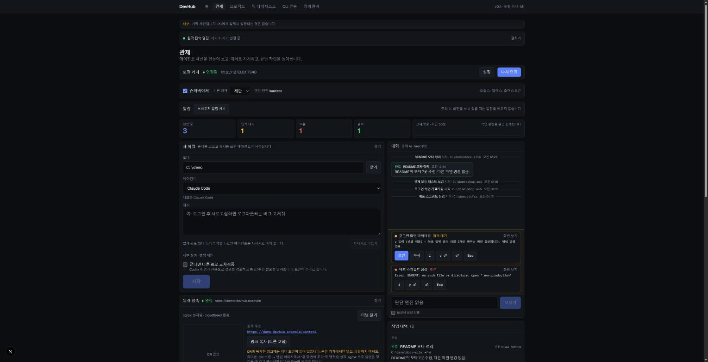

# DevHub 관제

여러 AI 코딩 에이전트(Claude Code, Codex)를 PC에서 돌려 두고, 어느 세션이 답을 기다리는지 한 화면에서 보고, 폰에서도 답하는 관제 도구입니다. 슈퍼바이저가 입력 대기와 오류를 읽어 답을 제안하거나 정해 둔 범위 안에서 직접 답합니다.



## 시작하기

명령은 모두 이 프로젝트 폴더(`Portfolio/BaekDiscord`)에서 실행합니다. PowerShell과 bash 어느 쪽에서도 그대로 됩니다. Node 22가 필요합니다(`.nvmrc`).

**1. 데모: 아무것도 필요 없음**

```
npm install
npm run demo
```

가짜 세션 네 개(작업 중, 입력 대기, 오류, 완료)와 열린 터널 표시로 관제 화면이 브라우저에 뜹니다. Claude Code, API 키, 토큰이 없어도 되고 PC에서 실제로 실행되는 것은 없습니다. 화면 위쪽에 "데모" 표시가 늘 보입니다. 첫 실행은 화면 컴파일에 30초쯤 걸립니다. 끝내려면 Ctrl+C.

**2. 로컬: Claude Code 필요**

```
npm run dev
```

러너(127.0.0.1:7331)와 웹(3000)이 같이 뜹니다. 러너 로그의 `dashboard: http://127.0.0.1:7331/control#rt=...` 링크를 열면 토큰이 저장되고, 거기서 새 작업을 시작합니다.

**3. 원격: ngrok 또는 cloudflared 필요**

관제 화면의 "원격 접속"에서 터널을 열고 QR을 폰으로 찍습니다. 터널은 관제 화면과 러너 API만 열고, 연결된 기기 없이 60분이 지나면 저절로 닫힙니다. 자세한 내용은 아래 [보안 모델](#보안-모델).

**스크립트와 에이전트에서 쓰기 (`devhubctl`)**

```
npm run ctl -w runner -- sessions
npm run ctl -w runner -- create --preset claude-print --cwd D:/Projects/my-app --prompt "테스트 돌리고 실패 원인 정리"
npm run ctl -w runner -- output <세션 id> --lines 60
```

## 구조

```
web/      Next.js 16 앱: 관제(/control), 프로덕트, CLI 콘솔, 컴파일러, 팀 다이제스트(/teams, 2026-12-31 보관 예정). PWA.
runner/   로컬 러너: PTY 세션, 슈퍼바이저, 관제 AI, 컴파일, 터널, 웹 프록시. runner/src/demo 는 데모용 가짜 러너.
runner/bin/devhubctl.mjs   러너 제어 CLI (Claude Code 스킬 `devhub-runner`가 사용)
android/  Kotlin WebView 셸 + 알림 서비스
scripts/  dev.mjs(러너+웹 동시 실행), demo.mjs, check-protocol.mjs
docs/     설계 문서
```

설계 문서: 현재 계획 [`docs/designs/devhub-next-20261113.md`](docs/designs/devhub-next-20261113.md)(2026-11-14 승인), 이력 [`devhub.md`](docs/designs/devhub.md)(팀 다이제스트, 2026-09-22), [`devhub-addendum-20260926.md`](docs/designs/devhub-addendum-20260926.md), [`devhub-addendum-20261004.md`](docs/designs/devhub-addendum-20261004.md).

팀 다이제스트(`/teams`)는 GitHub OAuth가 필요합니다. `web/.env.example`을 `web/.env.local`로 복사해 채우세요. OAuth 없이 화면만 보려면 `DEV_LOGIN=1`로 웹을 띄웁니다(bash: `DEV_LOGIN=1 npm run dev:web`, PowerShell: `$env:DEV_LOGIN=1; npm run dev:web`). 2026-12-31까지 실사용 팀(M0)이 생기지 않으면 보관 처리합니다.

## 기능

### 관제 (`/control`) — CLI·AI 에이전트 종합 관제
- **세션 보드**: 세션마다 상태(시작 중 · 작업 중 · 입력 대기 · 대기 · 오류 · 완료 · 종료됨), 마지막 출력 줄, 경과 시간, 목표, 정책, 슈퍼바이저 제안(승인/무시), 빠른 입력(y⏎ · ⏎ · Ctrl+C · Esc), 터미널 펼치기.
- **작업 현황 시각화**: 세션별 출력 활동 스파크라인(30초 단위 30분), 작업 폴더의 git 브랜치·ahead/behind·변경 파일(+/−)·최근 커밋. 상단 타일에 실행 중/입력 대기/오류/완료 집계와 전체 활동 그래프.
- **새 작업**: 폴더 탐색기로 폴더를 고르고(프로젝트 표시, 최근 수정, 지금 CLI가 켜진 폴더와 Claude 마지막 작업 시각) 지시를 쓰면 세션이 뜹니다. **지시서로 다듬기**는 프롬프트 모델이 짧은 지시를 목표·할 일·지키기·완료 기준·보고가 있는 지시서로 바꿔 미리 보여줍니다.
- **대화 (메신저형)**: 관제 AI와의 대화에 세션 시작·완료 알림이 섞여 흐르고, 입력을 기다리는 세션은 승인·`1`·`y⏎`·Esc 버튼이 달린 카드로 입력창 위에 고정됩니다. 관제 AI는 자연어를 도구 호출(세션 목록·출력 읽기·입력·생성·종료·목표/정책·제안 승인·폴더 탐색·지금 켜진 폴더·작업 내역)로 바꿔 실행하고, 세션을 띄울 때는 지시서 형태로 프롬프트를 써서 넘깁니다.
- **작업 내역**: 끝난 세션을 `runner/.data/worklog.jsonl`에 남깁니다. 결과, 마지막 출력, 세션 시작 시점 대비 git 변경량, 요약(기본은 규칙, "AI로 요약"을 누르면 프롬프트 모델). "이 지시로 다시"로 같은 지시를 재실행합니다.
- **교차검증**: 끝난 작업을 다른 AI가 읽기 전용으로 검토합니다(Claude Code가 한 일은 Codex가, Codex가 한 일은 Claude가). 세션 시작 시점 대비 그 세션의 diff와 원래 지시를 넘기고, 검토자는 테스트 실행 같은 읽기 전용 확인 후 통과·수정 필요·판단 보류와 P1~P3 지적을 냅니다. 리뷰 / 깨뜨려 보기 두 모드. 새 작업에서 "끝나면 다른 AI로 교차검증"을 켜면 자동으로, 내역에서 버튼으로 수동으로 시작합니다. 수정 필요면 "원래 AI에게 고치게 하기"가 지적 목록과 확인 절차가 든 지시를 새 작업에 채웁니다. Codex는 `--sandbox read-only`, Claude는 `--permission-mode plan`으로 돌아 파일을 바꾸지 못합니다. 관제 AI의 `cross_review` 도구와 `devhubctl review <id> --wait`로도 씁니다.
- **모델 역할 분담**: 다듬기·요약 같은 짧은 일은 프롬프트 모델(판단 엔진과 같은 `api` 또는 `claude -p`), 실제 코드 작업은 Claude Code·Codex 세션. 모델 호출은 클라이언트당 분당 12회로 제한합니다.
- **이벤트 로그**: 슈퍼바이저 판단, 사람의 조작, 관제 AI의 행동을 누가(actor) 언제 했는지 모두 남깁니다(감사 로그).
- **원격 접속**: ngrok 또는 cloudflared 터널을 한 버튼으로 열고 QR을 띄웁니다. 폰에서 QR을 찍으면 토큰이 들어간 링크로 바로 접속됩니다.
- **연결 복구**: 러너와의 WebSocket이 끊기면 1초→30초 지수 백오프(지터)로 자동 재연결하고 "끊김 · N초 후 다시 연결"을 보여줍니다. 25초마다 핑을 보내 55초 넘게 응답이 없는 소켓은 닫고 다시 잇습니다(폰 절전 후 반쯤 열린 소켓 대비). 탭 복귀·네트워크 복구 시에는 바로 연결합니다. 연결됨 옆에 왕복 지연(ms)이 보입니다.
- **알림과 배지**: 입력 대기·오류·제안이 있는 실행 중 세션 수를 탭 제목 `(N)`과 PWA 앱 배지(99+ 상한)에 표시합니다. 브라우저 알림을 켜면 세션이 입력 대기·오류·확인 필요·완료/실패로 **바뀔 때** 알림이 오고, 대시보드를 보고 있는 동안에는 울리지 않습니다. 방해 금지 모드(모두 알림 / 확인 필요만 / 방해 금지)를 고를 수 있고, 입력 대기 알림에는 `y ⏎` · `⏎` · `Esc` 버튼이 달려 알림에서 바로 답할 수 있습니다(프로덕션 빌드의 서비스워커가 있을 때). 설계 근거: [`docs/designs/devhub-ref-analysis-20261106.md`](docs/designs/devhub-ref-analysis-20261106.md).

### 프로덕트 (`/products`, 폰은 관제의 "제품" 탭)
- 러너 루트 아래 프로젝트 폴더를 자동으로 찾습니다(빌드·패키지 표시가 있는 폴더, 없으면 git/README/CLAUDE.md만 있는 말단 폴더). 분류 폴더(App, Games…)는 건너뜁니다.
- **활동 히트맵**: 프로덕트 × 최근 12주. 커밋, Claude Code 대화(~/.claude/projects 기록), 러너 작업, 아직 커밋 안 한 파일의 수정 시각(하루 1건)을 합칩니다. 활동 없는 줄은 접힙니다.
- **상태**: 활발(7일 이내) · 정체(30일 이내) · 방치. **손볼 것**: 3일 넘은 미커밋 변경, 미푸시 커밋, 배포 응답 없음, 마지막 작업 실패, 교차검증 수정 필요.
- **관리**: 단계(아이디어·개발·검증·배포·유지·보관), 메모, 배포 주소, 고정, 숨기기. `runner/.data/products.json`에 저장.
- **보조**: "AI 점검"은 프롬프트 모델이 README·최근 커밋·미커밋 변경·작업 내역·메모를 읽고 현재 상태, 다음 할 일 3개, 위험을 정리합니다. 각 할 일은 "작업으로"를 눌러 바로 새 작업이 됩니다. "배포 확인"은 배포 주소에 요청을 보내 응답 코드와 시간을 기록합니다. 관제 AI도 `list_products` 도구로 "뭐 방치됐어?" 같은 질문에 답합니다.

### 슈퍼바이저 (자율 판단)
- 3초마다 각 세션의 최근 출력을 규칙으로 1차 판정합니다: 예/아니오 질문, Enter 대기, 선택 메뉴(Claude Code 권한 프롬프트 포함), 셸 프롬프트, 오류, 침묵.
- 정책 세 단계: **수동**(관찰·알림만) · **제안**(판단 엔진이 응답을 제안, 사람이 승인) · **자율**(안전한 입력은 스스로 전송, 나머지는 사람에게).
- **안전 규칙**: 삭제·force push·배포·비밀값·시스템 변경이 출력에 보이면 정책과 무관하게 항상 사람 확인으로 올립니다. 자율 모드가 스스로 보내는 입력은 `y`/`n`/번호/Enter 같은 단순 응답뿐이며 신뢰도 0.7 이상일 때만입니다.
- **판단 엔진** (`SUPERVISOR_BRAIN`): `api`(Anthropic API, `ANTHROPIC_API_KEY`) → `claude-cli`(설치된 Claude Code의 `claude -p`, 키 불필요) → `heuristic`(규칙만). 기본 `auto`는 이 순서로 고릅니다.
- **알림**: `SUPERVISOR_NOTIFY_WEBHOOK`(디스코드 웹훅)에 입력 대기·확인 요청을 보냅니다(세션당 60초 디바운스, 비밀값 마스킹).

### 토큰 최적화
- 판단 엔진은 상태가 **입력 대기로 바뀔 때만** 호출합니다. 같은 출력(해시)에는 다시 묻지 않고, 세션당 30초 쿨다운이 있습니다. 위험 신호가 있으면 LLM을 부르지 않고 바로 사람에게 올립니다.
- 출력 꼬리는 반복 줄 압축·박스 문자 제거·2.4KB 상한·비밀값 마스킹 후 보냅니다. 채팅 히스토리는 최근 12턴만, 이전 도구 결과는 한 줄로 접습니다.
- API 엔진은 시스템 프롬프트에 프롬프트 캐시를 겁니다. 호출 수·입출력 토큰은 대시보드 상단과 `/runner/supervisor`에서 보입니다.
- `claude-cli` 엔진은 호출마다 Claude Code 자체 시스템 프롬프트(약 3~4만 토큰, 대부분 캐시 읽기)가 붙습니다. 자주 쓰면 API 키를 넣고 `api` 엔진을 쓰는 편이 훨씬 쌉니다. 모델은 `SUPERVISOR_MODEL`로 바꿉니다(기본 `claude-opus-5`).

### CLI 다중 제어 콘솔 (`/console`)
- 프리셋: Claude Code(대화형 / `claude -p` 1회), Codex(대화형 / `codex exec` 1회), PowerShell, 사용자 지정 명령. 세션마다 xterm.js 타일, 선택 세션에 입력 브로드캐스트, 여러 폴더 일괄 실행.

### 컴파일러 (`/compile`)
- C(gcc) · C++(g++) · Python · Java(`Main`) · JavaScript · TypeScript · Rust · Go. stdin·시간 제한·출력 캡, 예상 출력이 있으면 백준식 채점.

### 팀 다이제스트 (설계 M1, `/teams`)
- GitHub App 웹훅 → 매일 21:00 KST Discord 발행, 발행 후 60분 본인 행만 편집, 점수·등수 없음. 자세한 내용은 설계 문서.

## 모바일 / 원격 (앱)
1. 대시보드 **원격 접속 → ngrok 열기** (또는 `RUNNER_TUNNEL=1 npm run dev:runner`).
2. 폰으로 QR을 찍습니다. 링크의 `#rt=` 토큰이 폰에 저장되고 주소창에서 지워집니다. ngrok 무료 플랜은 첫 접속에 경고 페이지가 뜨니 Visit Site를 누릅니다.
3. 폰 브라우저 메뉴에서 **홈 화면에 추가**: 독립 창으로 뜨는 PWA 앱(`DevHub 관제`)이 됩니다. 오프라인이면 안내 페이지가 뜨고, `/runner/*`는 절대 캐시하지 않습니다.
4. 끝나면 **터널 닫기**. 터널 주소는 매번 바뀌며, 토큰이 유출됐다고 생각되면 `runner/.runner-token`을 지우고 러너를 재시작하세요.

폰 화면은 하단 탭(대화 · 세션 · 새 작업 · 내역)으로 된 전체 화면 앱입니다. 세션의 **터미널**은 전체 화면으로 열리고, Esc · ⇧Tab(모드 전환) · 화살표 · 1/2/3 키 버튼, `/compact` 같은 명령 바로가기, 한글 입력창(여러 줄은 붙여넣기로 한 메시지)을 제공합니다.

### 안드로이드 앱 (`android/`)
웹 대시보드를 그대로 담은 네이티브 셸입니다(Kotlin, minSdk 26).
- **연결**: 처음 열면 PC 대시보드의 원격 접속 QR을 찍거나 링크를 붙여 넣습니다. 연결 정보는 앱 안에만 저장되고, 러너 주소 밖의 링크는 일반 브라우저로 엽니다.
- **백그라운드 알림**: 세션 탭의 앱 칸에서 켭니다. Firebase 없이 앱이 러너와 WebSocket 하나를 유지하면서 입력 대기·오류·작업 완료·교차검증 결과를 알림으로 띄웁니다. 답하면 입력 대기 알림은 사라집니다. 켜 둔 동안 "DevHub 알림 대기" 상태 알림이 보입니다.
- **ngrok**: 앱은 브라우저가 아닌 User-Agent를 써서 ngrok 경고 페이지 없이 바로 열립니다.
- **빌드**: `cd android && JAVA_HOME="C:/Program Files/Android/Android Studio/jbr" ./gradlew.bat assembleDebug` → `android/app/build/outputs/apk/debug/app-debug.apk`. `android/local.properties`에 `sdk.dir`가 필요합니다.
- 에뮬레이터에서 PC 러너를 볼 때는 `http://10.0.2.2:7331/control#rt=<토큰>`으로 연결하고, 러너를 `RUNNER_ALLOWED_ORIGINS`에 `http://10.0.2.2:7331`을 더해 띄웁니다.

### PC 창과 폰이 같은 Claude Code를 보기 (`dclaude`)
`runner/bin`을 PATH에 넣고 `claude` 대신 `dclaude`로 실행합니다. 인자는 그대로 넘어갑니다(`dclaude --continue`, `dclaude --resume <id>`).
- 세션은 러너에서 돌고, 이 창은 그 세션에 붙은 화면입니다. 폰 대시보드에도 **PC 공유** 표시로 같은 화면이 보이고, 어느 쪽에서 입력해도 됩니다.
- PTY 크기는 PC 창이 정합니다. 폰은 글꼴을 줄여 같은 격자를 보여줍니다.
- `Ctrl+]`는 이 창만 분리합니다(세션은 계속 실행). 다시 붙기: `devhubctl attach <id>`.
- 이미 열려 있는 일반 `claude` 창에는 나중에 붙을 수 없습니다. 폰으로 이어받으려면 새 작업의 **Claude Code (이전 대화 이어서)**(`claude --continue`)를 쓰세요.

Claude Code에서 이 러너를 쓰려면 `/devhub-runner` 스킬(`D:\Projects\.claude\skills\devhub-runner`)이 `devhubctl` 사용법을 제공합니다.

## 러너 환경 변수

| 변수 | 기본 | 설명 |
| --- | --- | --- |
| `RUNNER_TOKEN` | 자동 생성(`runner/.runner-token`) | 모든 API·WS 인증 토큰 |
| `RUNNER_PORT` / `RUNNER_HOST` | 7331 / 127.0.0.1 | 바인딩. 외부 노출은 터널로만 |
| `RUNNER_CWD_ROOT` | 저장소 세 단계 위(`D:\Projects`) | 세션 작업 폴더 상한 |
| `RUNNER_WEB_PROXY` | `http://127.0.0.1:3000` | `/runner` 밖 경로를 넘길 Next 서버(`off`로 비활성) |
| `RUNNER_ALLOWED_ORIGINS` | localhost:3000 · 127.0.0.1:3000 · :7331 | 브라우저 Origin 화이트리스트(터널 URL은 자동 추가) |
| `RUNNER_TUNNEL` | – | `1`이면 시작 시 터널 자동 열기 |
| `RUNNER_TUNNEL_PORT` | `RUNNER_PORT`+1 (7332) | 터널 전용 수신 포트(127.0.0.1). 터널은 이 포트로만 붙고, 쓰이고 있으면 빈 포트로 대신 엽니다 |
| `RUNNER_TUNNEL_IDLE_MIN` | 60 | 연결된 원격 기기 없이 이만큼 지나면 터널 자동 닫힘(실행 중 세션이 있으면 한 번 연장). `0`은 끔 |
| `RUNNER_TUNNEL_MAX_HOURS` | 24 | 터널을 연 뒤 이만큼 지나면 기기가 있어도 닫힘. `0`은 상한 없음 |
| `SUPERVISOR_ENABLED` | 1 | `0`이면 관찰 루프 정지 |
| `SUPERVISOR_DEFAULT_POLICY` | assist | manual · assist · auto |
| `SUPERVISOR_BRAIN` | auto | api · claude-cli · heuristic |
| `SUPERVISOR_MODEL` | claude-opus-5 (api) | 판단 모델 |
| `ANTHROPIC_API_KEY` | – | api 엔진 |
| `SUPERVISOR_NOTIFY_WEBHOOK` | – | 디스코드 웹훅 URL |
| `SUPERVISOR_INTERVAL_MS` | 3000 | 관찰 주기 |

## 보안 모델
- 러너는 127.0.0.1에만 바인딩하고, 브라우저 Origin 화이트리스트와 Bearer 토큰(상수시간 비교)을 요구합니다. `/runner/health`만 공개.
- 로컬 포트(7331)는 Host 헤더가 localhost·127.0.0.1(또는 `RUNNER_ALLOWED_ORIGINS`의 호스트)일 때만 응답합니다(DNS 리바인딩 차단).
- 터널은 별도의 터널 전용 포트로만 연결됩니다. 이 포트로는 관제 화면(`/control`과 그 정적 파일, manifest, 서비스워커)과 러너 API만 열리고, 팀 다이제스트·`/api/*`·콘솔·컴파일러 화면은 404입니다. 원격 연결에서는 터널을 새로 열 수 없습니다.
- 터널이 열려 있으면 관제 화면 맨 위에 "원격 접속 열림 · 기기 N · 자동 닫힘 시각"이 늘 보입니다. 러너가 20초마다 핑을 보내 응답 없는 소켓은 끊고, 연결된 원격 기기가 없는 상태가 이어지면 터널을 자동으로 닫습니다(위 환경 변수). 터널이 닫히면 원격 기기는 닫힘 코드 4005를 받고 다시 연결을 시도하지 않습니다.
- WebSocket은 연결 후 5초 안에 인증해야 하고, 인증 전 연결은 20개·메시지 1KB로 제한됩니다.
- 인증 실패 5회(10분)면 그 클라이언트는 15분 잠금(HTTP·WS 공통). 잠금 키는 로컬 포트에서는 소켓 주소, 터널 포트에서는 터널 사업자가 붙인 주소(ngrok은 `X-Forwarded-For`의 마지막 항목, cloudflared는 `CF-Connecting-IP`)라서, 클라이언트가 헤더를 바꿔 잠금을 피하거나 PC 앞의 사용자를 잠글 수 없습니다.
- 세션(에이전트)에는 `RUNNER_TOKEN` 환경 변수를 넘기지 않습니다. 전체 요청 240/분, 컴파일 20/분 제한. WS 메시지 256KB, 입력 16KB, 코드 200KB 상한.
- 세션 cwd·관제 AI의 폴더 탐색은 `RUNNER_CWD_ROOT` 안으로 제한. Windows 시스템 폴더(`Windows`, `Program Files`, `ProgramData`, `AppData`, `Recovery`, `$Recycle.Bin` 등)는 이름 기준(대소문자 무시)으로 숨기고 열지 않습니다. 세션 id 등은 형식 검증.
- 관제 AI와 자율 모드는 파괴적 패턴(rm -rf, force push, DROP, 배포, 비밀값…)을 거부하거나 사람에게 올립니다. 채팅에서 "확인"을 명시하거나 `--confirm`일 때만 통과.
- 밖으로 나가는 텍스트(판단 엔진 프롬프트, 알림)는 토큰·키·비밀번호 형태를 `[REDACTED]`로 마스킹.
- 응답 헤더: `X-Content-Type-Options`, `X-Frame-Options: DENY`, `Referrer-Policy`, `Cache-Control: no-store`. 웹은 CSP·보안 헤더를 `next.config.ts`에서 적용.
- 샌드박스는 아닙니다. 자기 PC·자기 코드 전용이며, 터널은 쓸 때만 열고 닫으세요.

## 명령

| 명령 | 설명 |
| --- | --- |
| `npm run demo` | 데모 (가짜 러너 + 웹, 브라우저 열기). `--check`는 /control 200 확인 후 종료(CI용) |
| `npm run dev` | 러너 + 웹 동시 실행 (Windows 포함, Ctrl+C로 둘 다 종료) |
| `npm test` | 러너(123) + 웹(51) vitest |
| `npm run typecheck` | 러너 + 웹 `tsc --noEmit` |
| `npm run check:protocol` | `runner/src/protocol.ts`와 `web/lib/runner/protocol.ts` 사본 일치 검사 |
| `npm run build` | 러너 `tsc` + 웹 `next build` |
| `npm run lint` | 웹 eslint |
| `npm run ctl -w runner -- sessions` | devhubctl (health · sessions · create · send · output · kill · workspace · events · chat · tunnel · fs · claude · attach · worklog · review) |
| `npm run db:generate -w web` | Drizzle 마이그레이션 생성 |

## 러너 API (요약, 모두 `/runner` 아래)

| 경로 | 설명 |
| --- | --- |
| `GET /health` | 토큰 불필요. 버전 · cwd 루트 · 세션 수 · 터널/슈퍼바이저 상태 |
| `GET /sessions` · `POST /sessions` | 목록 · 생성(`preset, cwd, prompt, goal, policy, command`) |
| `POST /sessions/:id/input {data}` · `POST /sessions/:id/kill` | 입력 · 종료 |
| `GET /sessions/:id/output?lines=` · `GET /sessions/:id/workspace` | 출력 꼬리 · git 현황+활동 |
| `GET /events` · `GET /supervisor` · `GET /tunnel` | 이벤트 · 슈퍼바이저 설정/토큰 · 터널 상태 |
| `POST /chat {text, confirm?}` | 관제 AI |
| `POST /compile` | 컴파일·실행·채점 |
| `WS /ws?token=` | 위 전부 + `set_goal` · `set_policy` · `suggestion` · `supervisor` · `tunnel` · `workspace` 실시간 |

프로토콜 타입: `runner/src/protocol.ts` (`web/lib/runner/protocol.ts`는 동일 사본).

## 마일스톤 상태 (2026-10-04)
- **M0 실명 팀장 확보**: 미완. M0 없이 M1을 실사용에 넣지 않습니다.
- **M1 팀 다이제스트**: 코드 완료 · 테스트 통과. GitHub App · Discord 웹훅 · Vercel cron 실연동은 자격 증명 후.
- **콘솔 · 컴파일러 · 관제 · 원격**: 로컬에서 동작 검증(브라우저 + devhubctl + ngrok 터널 왕복).
